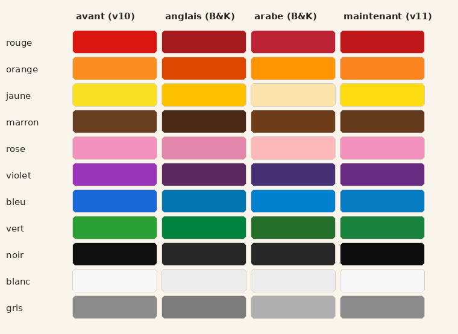
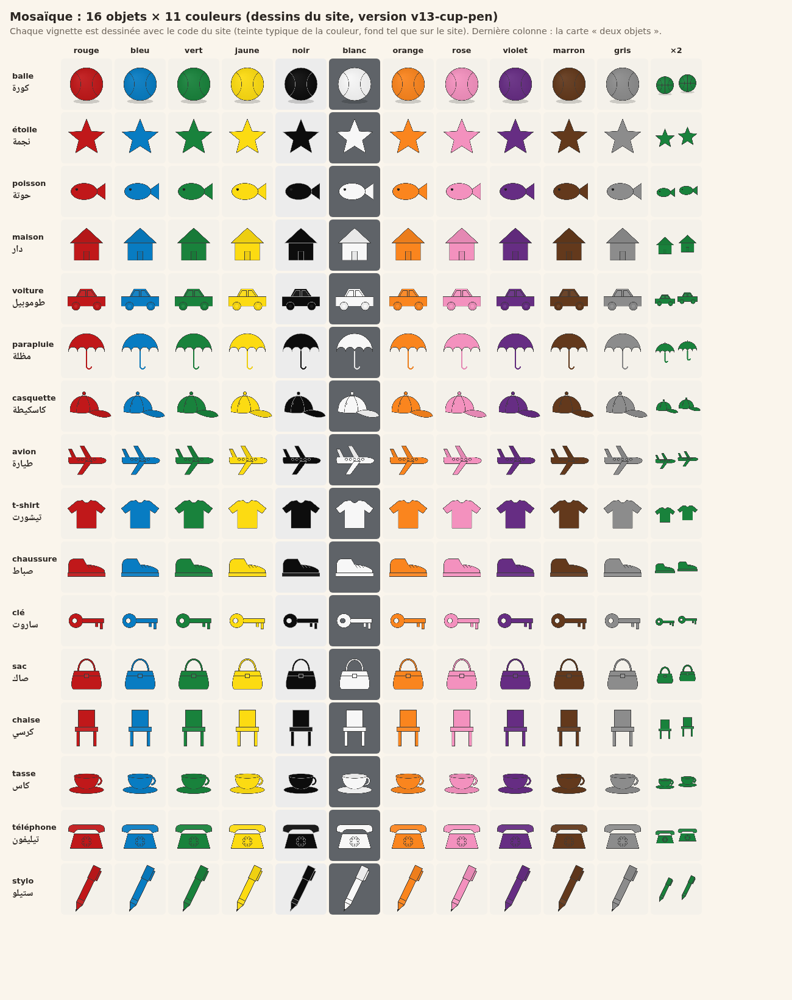

# Alwan bdarija · ألوان بالدارجة

A small website to collect voice recordings of Moroccan Darija speakers naming colours and objects,
for a research project.

Each participant answers series of 20 cards (up to 5 series). Every card shows a drawn object in a
random shade of a colour and asks a question in Darija; no words are given, so answers are spontaneous:
"شنو هاد اللون؟" (4 per series), "شنو هادشي؟" (4), "شنو هادشي، وشنو اللون ديالو؟" (7),
"شنو كتشوف؟" with two objects (3) and a free description (2). Every series shows all 11 colours and
all 16 objects (see below) in random pairs, so the shape never predicts the colour. The image shown and the
card's colour, object and question are saved with each recording, together with simple audio
level measures used to filter noisy recordings.

- `index.html`: the whole site (static, works on phones). Set `UPLOAD_URL` and `CONTACT` at the top of the script.
- `apps_script/Code.gs`: Google Apps Script web app that stores uploads in a Google Drive folder
  (setup steps in the file header).

Participants get a 6-character code; progress is remembered in the browser, and the code
lets them resume or ask for their recordings to be deleted. No names or e-mails are collected.

## Colours and how they were chosen

*For each colour: the site's previous centre, the Berlin & Kay focal ("best example") colour for English and for Arabic,
and the current centre ([docs/couleurs_reference.png](docs/couleurs_reference.png)).*

1. **Which colours.** The 11 basic colour terms of Berlin & Kay (1969): red, orange, yellow, green, blue, purple, pink,
   brown, black, white, grey. Lebanese Arabic, the closest variety to Darija in their data, has the same 11 categories.
   Common Darija words (participants use their own): حمر، ليموني / اورانج، صفر، خضر، زرق، موف / قوقي، وردي / روز،
   قهوي / ماروني، كحل، بيض، رمادي.
2. **Which shades.** Each card shows a random shade inside a narrow range around the colour's centre, so that the colour
   is a category rather than a single value, but no shade of one colour can look like another: every pair of colours
   stays above ΔE 30 in CIELAB (earlier versions had red / orange pairs as close as ΔE 13).
3. **Where the centres come from.** The focal colours of Berlin & Kay (public World Color Survey data,
   linguistics.berkeley.edu/wcs) for English and Arabic. Where both languages agree (red, green, blue, purple, brown),
   the centre is their average; yellow is made slightly more golden; orange, pink and grey, on which the two languages
   differ, stay close to typical values.
4. **How they are shown.** One colour per object, neutral grey outline, inner shading within ±6 % (a darker orange reads
   as brown, a lighter red as pink); neutral backgrounds (dark grey behind white objects, light behind black ones).

Limits: Berlin & Kay often had a single speaker per language; Lebanese Arabic is not Darija (e.g. purple is ليلكي there,
موف or قوقي in Darija); their colour chips are printed, less saturated than a screen; participants' screens are not
calibrated, so the colours they see vary slightly (the exact colour code shown is saved with each recording); an optional question
asks whether the participant confuses some colours (colour blindness), so these answers can be analysed apart.

## Objects and how they were chosen

*All 16 objects × 11 colours, drawn by the site's own code ([docs/mosaique.png](docs/mosaique.png)); last column: the
"two objects" card.*

| Feminine | Masculine |
|---|---|
| ball (كورة), star (نجمة), fish (حوتة), house (دار) | t-shirt (تيشورت), shoe (صباط), key (ساروت), bag (صاك) |
| car (طوموبيل), umbrella (مظلة), cap (كاسكيطة), plane (طيارة) | chair (كرسي), cup (كاس / فنجال), phone (تيليفون), pen (ستيلو) |

Criteria:
1. **Exists in any colour.** No object has a typical colour, so the shape never gives the colour away.
   Removed for this reason: heart (typically red) and box (typically brown cardboard).
2. **Recognised at a glance in a simple drawing, with one obvious name.** A drawing that can be named as something
   else gives a wrong label: the ball is drawn as a shaded ball with seams (not a flat circle), the bag as a
   handbag (not an envelope), the cup as a teacup on its saucer (a bucket-like cup, then a mug read as a jug, were rejected), the phone as a desk telephone (a smartphone screen would
   add a second colour). The pen is drawn in writing position, tip down with a small black point (pointing up, it was read as a rocket).
   Not kept: a book (could be named as a notebook, كناش) and a sandal (unclear when drawn).
3. **Its name does not sound like a colour word.** Removed: flower (وردة, too close to وردي, pink).
4. **Grammatical gender balanced**: 8 feminine and 8 masculine nouns, so colour agreement (حمر / حمرا) is heard in both forms.
5. **Visually distinct from one another**, and **everyday objects** in Morocco.

Drawing rules: each object is a single colour (neutral grey outline; inner shading within ±6 %, since a darker orange
reads as brown and a lighter red as pink; the structure is given by the outlines), and each colour's
shades stay in a narrow range so that no shade of one colour looks like another (every pair above ΔE 30 in CIELAB).
Colour centres follow the focal ("best example") colours of Berlin & Kay (1969) for English and Arabic where the two
agree (red, green, blue, purple, brown), from the public World Color Survey data (linguistics.berkeley.edu/wcs).
